<div align="center">


# Ultra-Realistic Cassette Deck

**A 1980s cassette deck in your browser: a 3D model with a tape transport, auto-reverse, tape hiss,
noise reduction, and wow and flutter, playing your own music.**

[Features](#features) · [Quick start](#quick-start) · [The deck](#the-deck) · [How the audio is wired](#how-the-audio-is-wired) · [FAQ](#faq)

[](LICENSE)


<picture>
  <source media="(prefers-color-scheme: dark)" srcset="docs/screenshots/desktop-dark.png">
  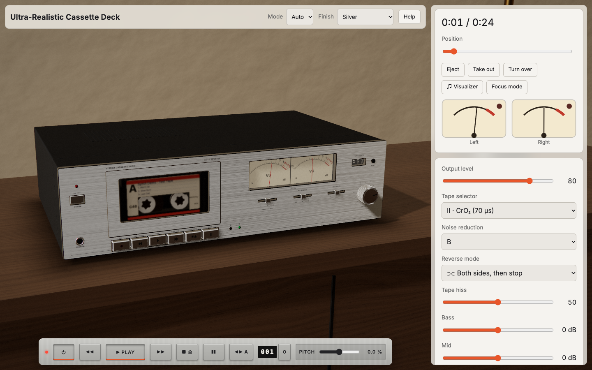
</picture>

</div>

Load your own music and it is recorded onto a cassette, side A then side B, the way a mixtape is
made. Press the piano keys on a silver front loader of the early 1980s: the solenoid pulls the head
in, the reels turn, the counter runs and the needles move. Hold fast forward during play to cue,
press Next to wind to the gap before the next track, let side A run out and the head turns over for
side B. Nothing leaves your device.

The deck is generic: it copies no real model and carries no maker's name. The next member of the
family that began with [Ultra-Realistic Vinyl Player](https://github.com/Gitguy268/ultra-realistic-vinyl-player),
built on its engine. The same source also builds one self-contained `ultra-realistic-cassette-deck.html`, attached to the
[release](https://github.com/Gitguy268/ultra-realistic-cassette-deck/releases/tag/latest): every
feature, double-click to run, no server.

<div align="center">
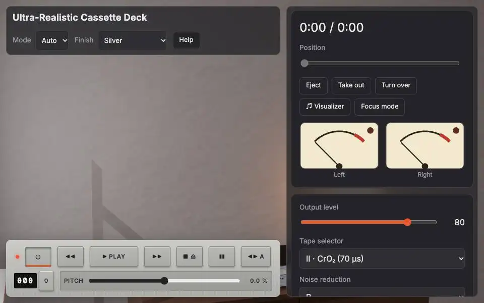
</div>

|                                           Phone, dark                                           |                                           Phone, light                                            |                                                   Black finish                                                   |
| :---------------------------------------------------------------------------------------------: | :-----------------------------------------------------------------------------------------------: | :--------------------------------------------------------------------------------------------------------------: |
| 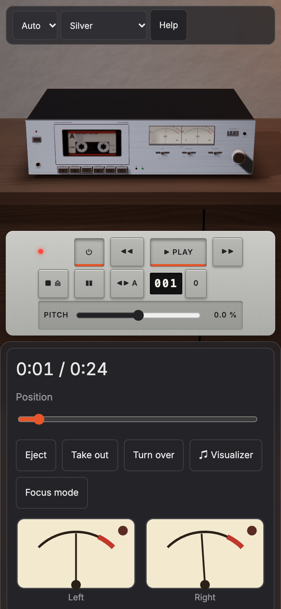 | 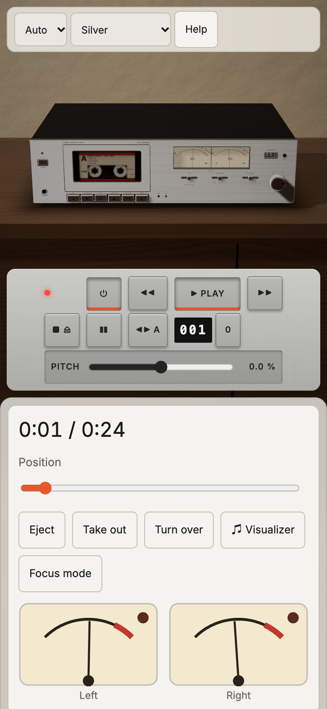 | 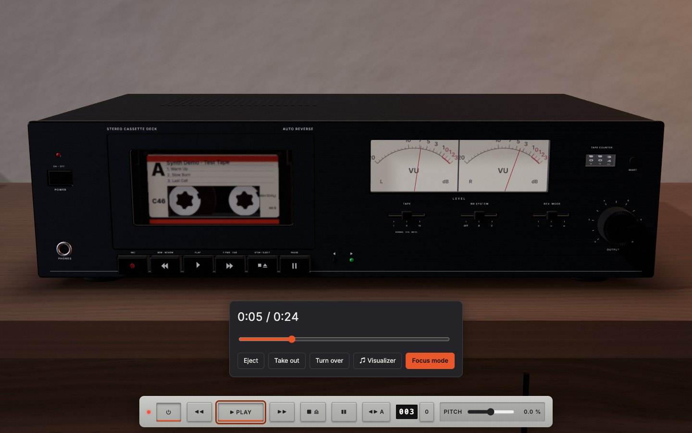 |

<!-- live-links -->

**Live:** [gitguy268.github.io/ultra-realistic-cassette-deck](https://gitguy268.github.io/ultra-realistic-cassette-deck/) · [gitguy268-ultra-realistic-cassette-deck.vercel.app](https://gitguy268-ultra-realistic-cassette-deck.vercel.app)
<!-- /live-links -->

<!-- run-steps:start -->

## Run it locally, step by step

1. **Install [Node.js](https://nodejs.org) 22** or newer.

2. **Get the code:**

   ```sh
   git clone https://github.com/Gitguy268/ultra-realistic-cassette-deck.git
   cd ultra-realistic-cassette-deck
   ```

3. **Install the dependencies:**

   ```sh
   npm ci
   ```

4. **Start it:**

   ```sh
   npm run dev
   ```

5. **Open <http://localhost:5190/>** in your browser. Press `Ctrl+C` in the terminal to stop.

Or, without Node: download `ultra-realistic-cassette-deck.html` from the
[latest release](https://github.com/Gitguy268/ultra-realistic-cassette-deck/releases/tag/latest) and
double-click it.
<!-- run-steps:end -->

## Features

| Feature                                                                                                    | Status                            |
| ---------------------------------------------------------------------------------------------------------- | --------------------------------- |
| Piano-key transport that latches: play, pause, stop (again to eject), fast wind, record (a dummy)          | Shipped                           |
| A tape at 4.76 cm/s with ±3 % pitch; fast wind that speeds up as the take-up pack grows                    | Shipped                           |
| Auto-reverse ⊐ / ⊃⊂ / ∞, the head turning; ◀▶ to turn it by hand                                           | Shipped                           |
| Cue and review at 7× while a wind key is held during play; music search to the gap before a track          | Shipped                           |
| The queue recorded as a mixtape onto C46, C60, C90 or C120, side A then B, more cassettes when one is full | Shipped                           |
| A three-digit mechanical counter that counts reel turns, with its reset button                             | Shipped                           |
| Noise reduction B and C as companders, tuned to the published reduction per frequency                      | Shipped                           |
| Tape hiss by type, playback EQ at 120 or 70 µs; a mismatched selector or NR switch sounds as it would      | Shipped                           |
| Head bump, treble saturation, azimuth error on side B, wow and flutter, in an AudioWorklet                 | Shipped                           |
| Condition New to Chewed: dropouts and creases at fixed places on the tape                                  | Shipped                           |
| Needle VU meters with VU ballistics and a lamp; LEDs for the play direction and the power                  | Shipped                           |
| A damped door, the cassette with its packs and hubs, a written label per side; out, turn over, back in     | Shipped                           |
| Mechanism sounds: keys, solenoid, eject spring, door latch, head turning, tape end, fast-wind whine        | Shipped                           |
| Winamp ten-band graphic EQ with 17 presets and .eqf import, shared with the vinyl player                   | Shipped                           |
| Label visualizer: MilkDrop, bars, lines, scope, spectrogram, radial                                        | Shipped                           |
| Library in IndexedDB: file, folder and drag-and-drop import, tags, cover art, liner notes                  | Shipped                           |
| Library desktop: artists and albums as folders, tracks to drag onto the deck                               | Shipped                           |
| Queue with shuffle, repeat and reordering; the tape position kept between visits; Media Session            | Shipped                           |
| Four finishes, daylight and dusk lighting; camera with an opening move, orbit, focus view and tour         | Shipped                           |
| A 2D deck with every control when WebGL is missing; recovery when the GPU drops the context                | Shipped                           |
| Installable PWA that works offline, with an update prompt                                                  | Shipped                           |
| Reduced motion, keyboard operation of every control, screen-reader announcements                           | Shipped                           |
| Recording                                                                                                  | Not planned: the deck only plays  |
| Cue and review in streaming mode (files over 150 MiB or 20 minutes)                                        | Not possible with a media element |

## Quick start

Requires Node 22.12 or newer.

```sh
git clone https://github.com/Gitguy268/ultra-realistic-cassette-deck.git
cd ultra-realistic-cassette-deck
npm ci
npm run dev
```

Open the printed URL, press **Add files**, then **Play** (on the strip, or the key on the deck).
`http://localhost:5190/?demo` plays three synthesized tracks without touching your library.

To try the production build instead, `npm start` builds it, serves it and opens it in your browser.
Opening `dist/index.html` directly as a file does not work (a browser will not load the scripts,
the audio worklet or the service worker from a `file://` address), and the page says so. The
one-file build is the one that runs from a file.

## Commands

| Command                 | What it does                                         |
| ----------------------- | ---------------------------------------------------- |
| `npm run dev`           | Start the Vite dev server on port 5190               |
| `npm run build`         | Type-check and build to `dist/`                      |
| `npm run build:single`  | Build the one-file `dist-single/index.html`          |
| `npm run preview`       | Serve the production build on port 4193              |
| `npm start`             | Build, serve and open the production build           |
| `npm run typecheck`     | Type-check without building                          |
| `npm run lint`          | ESLint                                               |
| `npm run format`        | Format everything with Prettier                      |
| `npm run test`          | Run the unit tests once                              |
| `npm run check:links`   | Check links in the Markdown files                    |
| `npm run check:browser` | Build and run every headless browser check           |
| `npm run verify`        | Lint, format check, type-check, test and both builds |

<details>
<summary>The 23 browser checks</summary>

`npm run check:browser` builds, serves the build on port 4194 and runs them all. They use the
Chromium that Playwright installs (`npx playwright install chromium`); set `BROWSER` to `firefox`,
`webkit` or `msedge` to run them in another engine.

| Script               | What it checks                                                                    |
| -------------------- | --------------------------------------------------------------------------------- |
| `check-tape`         | No clipping, hiss with and without NR, EQ and NR mismatches, wow and flutter, cue |
| `check-formats`      | Real WAV, FLAC, MP3, M4A and AIFF files: tags and playback                        |
| `check-transport`    | Play, pause, pitch, cue, review, music search, eject, fast wind, counter, power   |
| `check-reverse`      | Auto-reverse in all three modes, the ◀▶ key, the head turning, azimuth on side B  |
| `check-parts`        | Every key, switch, button, knob and the door, picked on the 3D model              |
| `check-sfx`          | Mechanism sounds, the fast-wind whine, Mechanical sounds off                      |
| `check-modes`        | `?demo`, `?selftest`, the debug tap                                               |
| `check-storage`      | Each build's own storage, the shared EQ, the tape position after a reload         |
| `check-fallback`     | No WebGL: the 2D deck with working controls                                       |
| `check-context-loss` | The GPU takes the context away: music goes on, the scene comes back               |
| `check-network`      | Nothing leaves the origin; what loads later is precached                          |
| `check-reduced`      | No intro or drift; the door and the turn-over happen at once                      |
| `check-label`        | Each side's written label: its own tracks, the tape, type and NR                  |
| `check-drop-cover`   | Page-wide drop, a dropped image as the cover                                      |
| `check-finishes`     | Each finish is its own material                                                   |
| `check-mobile`       | Phone layout, touch transport, background routing                                 |
| `check-visualizer`   | The ♫ button, each style on the label, the saved choice                           |
| `check-camera`       | Opening move, orbit limits, reframe, focus, tour, no scroll hijack                |
| `check-winamp`       | Graphic EQ and the library desktop                                                |
| `check-library`      | Folder import, winding to a chosen track, two cassettes, the next one going in    |
| `check-keyboard`     | Every shortcut, tab order, dialogs, focus mode                                    |
| `check-loading`      | Fast track switching, crossing a gap, streaming mode                              |
| `check-offline`      | Service worker, offline reload, update prompt                                     |

Run separately: `check-perf` (frame time and budgets, needs a dev server on 4195), `check-soak`
(ten minutes), `check-spec` (the two builds share one spec), `check-filenotice` (needs both builds),
`check-parity` (every row of [docs/PARITY.md](docs/PARITY.md) names evidence that exists).

</details>

## Deploying

The app is a static site. `vercel.json` sets the Vite preset and `dist` as the output directory, so
importing the repository into Vercel needs no further configuration. GitHub Pages builds it under
`/ultra-realistic-cassette-deck/` (`.github/workflows/pages.yml`): every path is relative, so the
manifest and the service worker work under a subpath too. Any static host works: run
`npm run build` and serve `dist/` over HTTPS (service workers and AudioWorklet need a secure
context). No environment variables are needed.

## The deck

The face, its layout and its timings are design values. What a cassette and its playback must be is
not: tape speed, shell and tape sizes, the playback equalisation and the behaviour of the noise
reduction are taken from cited sources in [docs/REFERENCE.md](docs/REFERENCE.md), and
`tests/reference.test.ts` holds both the spec and the sound to them.

<details>
<summary>What is modelled</summary>

Brushed aluminium face with its silkscreen and polished bevel, painted steel wrap with ventilation
slots, feet; a door on a bottom hinge with a smoked window and an oil damper, the cassette holder,
the well and the head block with its capstans and pinch rollers, which turns over for reverse; six
piano keys with legends, a power switch, a phones jack, LEDs; two needle meters behind glass with a
lamp; a three-digit counter whose wheels turn over like a real one; three slide switches; a knurled
output knob. The cassette has its shell with the trapezoid at the head opening, five screws, a
window, white hubs with their teeth and a clamp, the tape packs, and a paper label on each side.

|                                         Cassette in the door                                          |                                                   Meters                                                    |                                             Counter                                             |
| :---------------------------------------------------------------------------------------------------: | :---------------------------------------------------------------------------------------------------------: | :---------------------------------------------------------------------------------------------: |
| 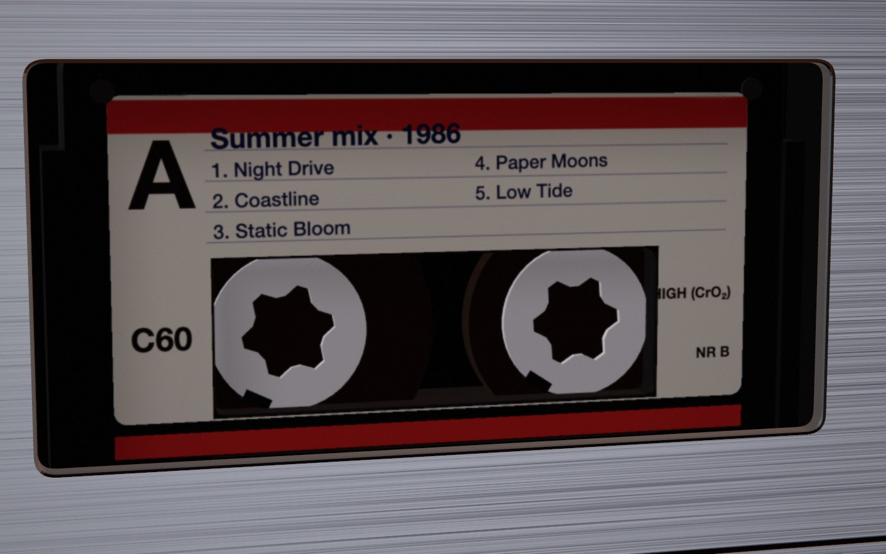 |              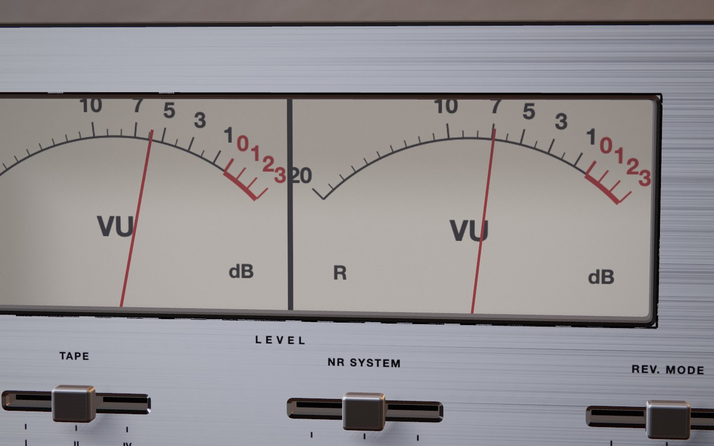              |        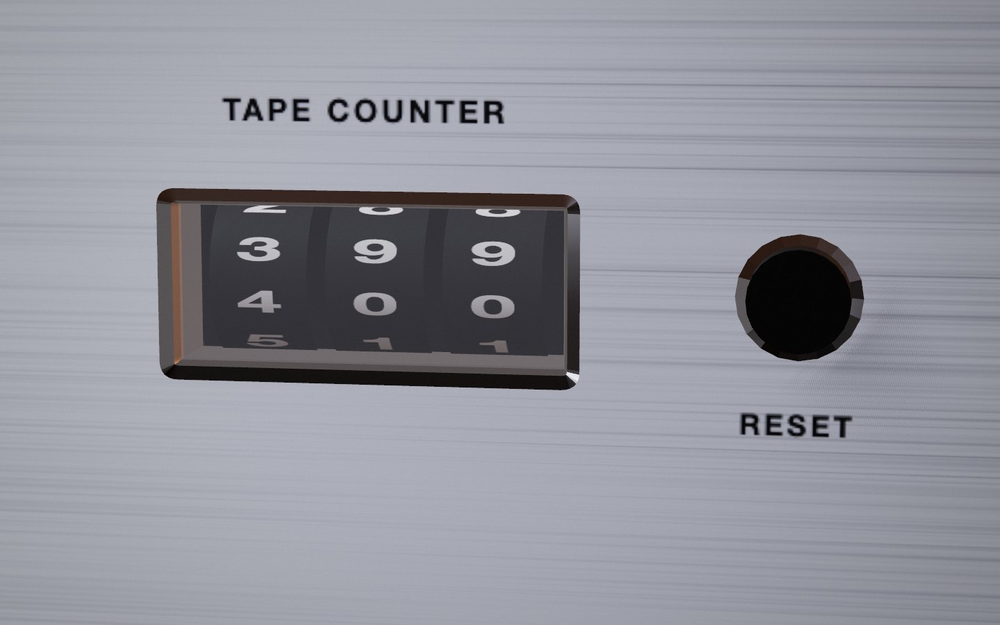        |
|                                               **Keys**                                                |                                                **Door open**                                                |                                       **Out of the deck**                                       |
|        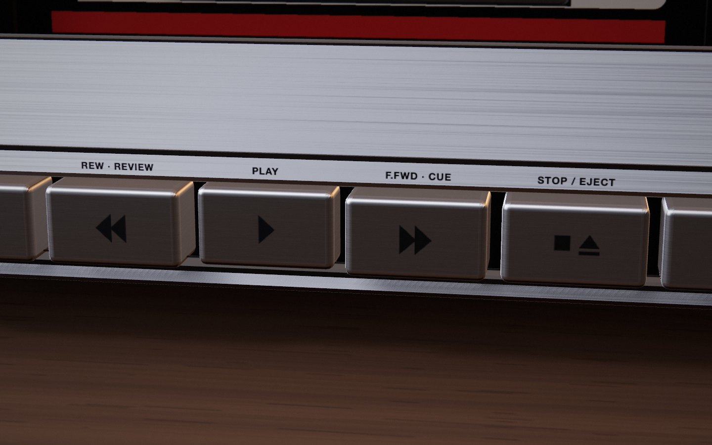        | 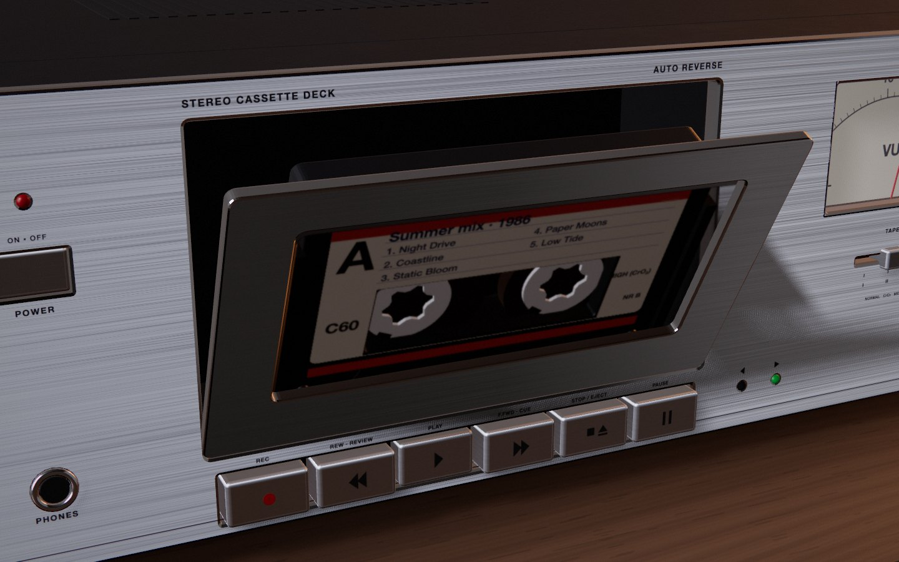 | 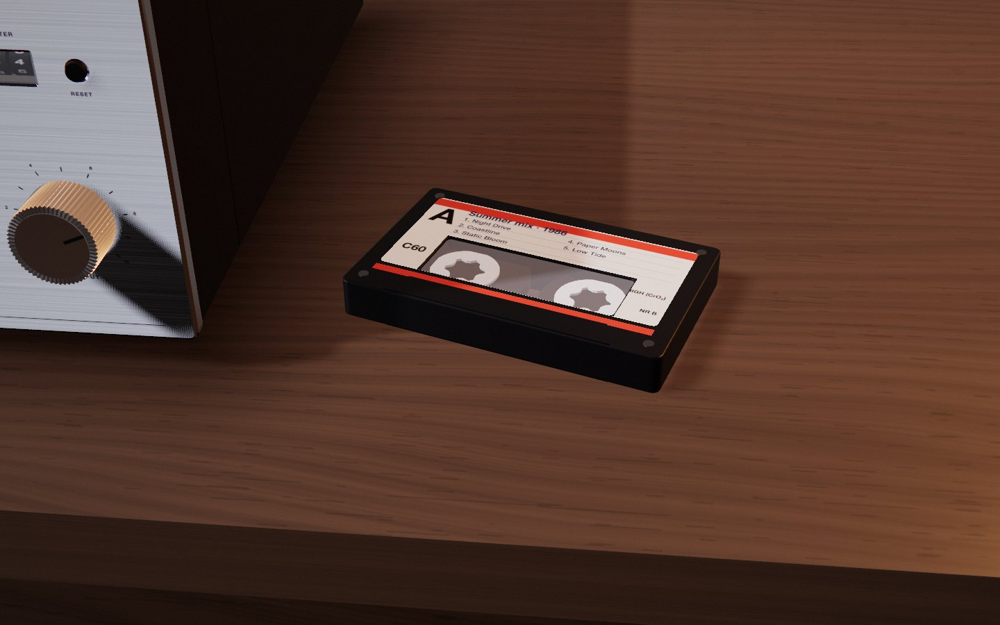 |

</details>

<details>
<summary>Performance, measured on an M-series Mac</summary>

At 1440 × 900: 139 scene draw calls, about 40k triangles, 91 MB of textures; locked to 60 Hz in use.
At 390 × 844 with DPR 2: 133 draw calls, also at 60 Hz. The smoked door is drawn through a
full-resolution transmission pass, so the label behind it stays sharp. With nothing moving for a
second the deck draws 4 frames a second; if frames average under 24 fps for two seconds the
resolution steps down.

</details>

## How the audio is wired

```text
 decoded buffer source ─┐            ┌──────────────────── tape worklet ────────────────────┐
 streaming <audio> ─────┴─► (rate = ─►│ wow and flutter ─► NR encode (the tape's) ─► saturation│
                             tape speed)│ ─► dropouts ─► + hiss ─► EQ (deck vs tape) ─► head bump │
 cue / review: the worklet reads       │ ─► treble loss ─► azimuth ─► NR decode (the deck's)    │
 the track at ±7×                       └───────────────────────────┬──────────────────────────┘
                                                                    ▼
                                    mute ─► trim ─► bass/mid/treble ─► graphic EQ ─► level ─► analyser ─► output
                                                                         └─► VU meters
 keys, solenoid, door, head, tape end, fast-wind whine ─► their own level ─────────────────────► output
```

- The transport (`src/core/transport.ts`) owns the tape: where it is and how fast it moves. The packs,
  the spokes, the counter and the read position all follow it, and in steady play the sound leads and
  the tape follows it, so the two never part.
- The tape is "recorded" in the worklet as well as played: the encoder stands for the cassette's noise
  reduction, the decoder for the deck's switch. That is why a mismatch sounds like one.
- Hiss is made in the worklet, ahead of the decoder, so noise reduction takes it down as it would.
  It follows the tape's speed past the head and stops when the tape does.
- The trim takes the EQ preamp and turns the music down by the largest boost the controls add, so
  nothing clips.
- The pure maths (tape geometry, transport, programme, wear, the DSP blocks, the queue) has no DOM or
  Web Audio dependency, is unit-tested, and is what the worklet imports.

## FAQ

**Why does the counter not show minutes?**
Because a real one does not. It is geared to a reel, so it counts turns: fast at the start of side A,
slow near its end, and backwards on side B. The time of the track under the head is in the panel.

**What do the tape selector and the NR switch do?**
They are the deck's. The cassette has its own type and was "recorded" with its own noise reduction
(both in **The cassette** settings). Matched, the sound is flat. A Type II tape on the Type I
setting (120 µs) comes out about 4.5 dB bright in the treble, more through NR, which then
mistracks. NR off on a tape recorded with B is bright and breathy, as it was on real decks.

**How accurate is the noise reduction?**
It is a model, written from the published description: one sliding-band stage for B, two in series
for C. It is tuned until it takes about 4, 6.5, 8.5 and 9.5 dB off the hiss at 600 Hz, 1.2, 2.4 and
5 kHz (published: 3, 6, 8, 10) and about 15 dB for C. It is not any company's circuit.

**Why does choosing a track take a while?**
The tape winds there, as a real deck would, at fast-wind speed: up to about a minute across a C60
side. Untick **Wind to a chosen track** to jump straight there; the seek bar and ← → always jump.

**Can it record?**
No. The record key is there because the deck had one; it says so when pressed.

**Why does a big file say "streaming mode"?**
Files up to 150 MiB and 20 minutes are decoded fully into memory, which allows sample-accurate cue and
review. Anything larger plays through an `<audio>` element: speed and pitch still follow the tape,
but cue and review only move the tape.

**Which browsers work?**
Current Chrome, Edge, Firefox and Safari (17.5 or newer). The 3D deck needs WebGL 2; without it the 2D
deck takes over. The app also needs AudioWorklet, IndexedDB and Canvas 2D. The browser checks run in
Chromium on macOS with a real GPU; phones are checked by emulation only.

**What happens to my files?**
Nothing leaves the device. There is no server, account, analytics or third-party request. Imported
audio is stored in your browser's IndexedDB, the queue, settings and the tape's position in
`localStorage`. **Clear library** removes the audio; the files on your disk are never modified.

**Is this affiliated with anyone?**
No. The deck copies no real model and shows no maker's name. Dolby and Compact Cassette are trademarks
of their owners; the switch on the deck reads "NR B / C".

## More

- [Reference](docs/REFERENCE.md) — the cited figures behind the tape and its sound
- [Decisions](docs/DECISIONS.md) and [parity with the vinyl player](docs/PARITY.md)
- [Contributing](CONTRIBUTING.md) — code style, commit rules, manual test matrix
- [Security policy](SECURITY.md)
- [Code of conduct](CODE_OF_CONDUCT.md)
- [License](LICENSE) (MIT)
- [Third-party notices](NOTICE)
- [Changelog](CHANGELOG.md)
